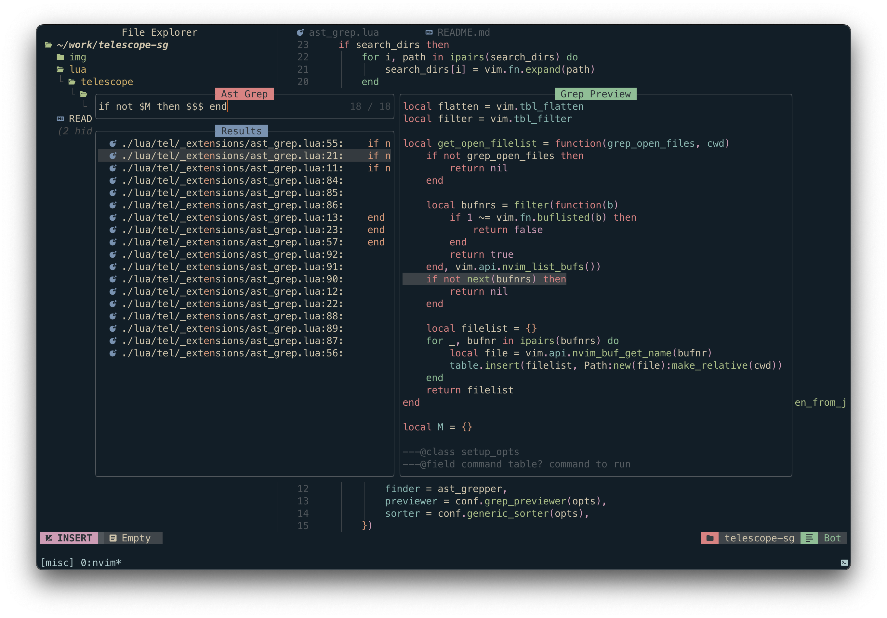

# Telescope ast-grep

ast-grep picker for telescope.nvim

Inspired by this [PR](https://github.com/nvim-telescope/telescope.nvim/pull/2611)



## Requires
  `ast-grep` to be installed ( version >= 0.10.0 ). You can install it by the following commands.
  ```bash
  npm install --global @ast-grep/cli
  pip install ast-grep-cli
  cargo install ast-grep
  ```

## What it does
  ast-grep is a AST-based tool to search code by pattern code. Think it as your old-friend grep but it matches AST nodes instead of text. You can write patterns as if you are writing ordinary code. It will match all code that has the same syntactical structure. You can use $ sign + upper case letters as wildcard, e.g. $MATCH, to match any single AST node. Think it as REGEX dot ., except it is not textual.

See [ast-grep](https://ast-grep.github.io/)

## Check Health
  Make sure you call `:checkhealth telescope` after intalling to ensure everything is set up correctly.

## Configuration

Note command can be a function too.

```lua
require('telescope').setup {
    extensions = {
        ast_grep = {
            command = {
                "sg", -- For Linux, use `ast-grep` instead of `sg`
                "--json=stream",
            }, -- must have --json=stream
            grep_open_files = false, -- search in opened files
            lang = nil, -- string value, specify language for ast-grep `nil` for default
        }
    }
}
```

## Scan

Provide command as a function in init. The function return a table with:
`{ "ast-grep", "scan", "--inline-rules", <your-rule>, "rule", "--json=stream" }`

```lua
local caller_rule = [[
language: csharp
rule:
  kind: method_declaration
  has:
    field: parameters
    has:
      kind: parameter
      regex: ^REPLACEME$
]]

opts.command = function(prompt)
  local rule = caller_rule:gsub("REPLACEME", prompt)

  return {
    "ast-grep", -- For Linux, use `ast-grep` instead of `sg`
    "scan",
    "--inline-rules",
    rule,
    "--json=stream",
  }
end
```

## Usage
```lua
Telescope ast_grep
```
